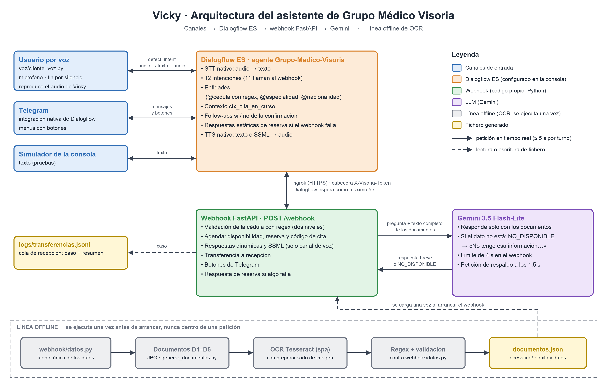

# Vicky · Asistente por voz de Grupo Médico Visoria

Vicky agenda citas médicas y responde las dudas de los pacientes **hablando**: Dialogflow ES reconoce lo que se dice, un webhook
en FastAPI aplica las reglas de la clínica y Gemini responde las preguntas con documentos procesados previamente con OCR.

> **Vídeo de demostración:** [https://www.loom.com/share/c8feadcc5a224d9badd42c9ce93e4c14](https://www.loom.com/share/c8feadcc5a224d9badd42c9ce93e4c14)
>
> La cita del vídeo se pide **a propósito con una paciente ya registrada**: María González (cédula 14523987) existe en los datos ficticios de la clínica ([`webhook/datos.py`](webhook/datos.py)), con una consulta anterior de dermatología con la Dra. Laura Rojas. Por eso Vicky la reconoce por su cédula, la llama por su nombre y le propone a su misma dermatóloga. Con un paciente nuevo, Vicky
> asigna un médico disponible de la especialidad y lo registra al confirmar la cita.

Evaluación final de *Herramientas de IA Clásica* (Máster en IA, Cloud Computing y DevOps). Todos los datos (clínica,
médicos, pacientes, documentos) son **ficticios**.

## Índice

1. [Caso de uso](#1-caso-de-uso)
2. [Arquitectura](#2-arquitectura)
3. [Agente Dialogflow](#3-agente-dialogflow)
4. [Webhook](#4-webhook)
5. [OCR y respuesta documental](#5-ocr-y-respuesta-documental)
6. [Voz](#6-voz)
7. [Mejoras opcionales](#7-mejoras-opcionales)
8. [Decisiones técnicas](#8-decisiones-técnicas)
9. [Qué pasa si algo falla](#9-qué-pasa-si-algo-falla)
10. [Resultados](#10-resultados)
11. [Cómo ejecutarlo](#11-cómo-ejecutarlo)
12. [Estructura del repositorio](#12-estructura-del-repositorio)
13. [Proceso de desarrollo: SDD](#13-proceso-de-desarrollo-sdd)
14. [Limitaciones y mejoras futuras](#14-limitaciones-y-mejoras-futuras)

---

## 1. Caso de uso

**Grupo Médico Visoria** es una clínica privada de Caracas (Venezuela) con seis especialidades (dermatología, endocrinología,
cirugía plástica, urología, cardiología y oftalmología) y doce médicos. Hoy recepción atiende por teléfono dos tipos de
llamada: pedir cita y hacer preguntas frecuentes (cómo llegar, precios, horarios, seguros, preparación para exámenes).
**Vicky**, la asistente virtual por voz, resuelve ambas: agenda la cita en una conversación de varios turnos (nombre,
nacionalidad, cédula validada con regex, especialidad, fecha y hora), reconoce a los pacientes que ya se atendieron y les
propone a su mismo médico, aplica los horarios reales de cada médico y pide confirmación; y responde las preguntas frecuentes
**solo** con la información de cinco documentos de la clínica leídos por OCR, diciendo explícitamente cuando algo no está en
ellos y ofreciendo pasar con recepción. También consulta horarios, historial, cancela citas y transfiere a una persona.
Funciona por voz y, como mejora, en Telegram con botones.

## 2. Arquitectura



*Diagrama generado por código: `uv run python docs/generar_diagrama.py`.*

**Recorrido de una petición por voz** ("¿Tienen estacionamiento?"):

1. El cliente de voz graba hasta detectar ~1,5 s de silencio y hace **una sola llamada** `detect_intent` con el audio, marcando
   el canal `voz`.
2. Dialogflow transcribe (STT nativo), clasifica la frase como `consulta_documental` y llama al webhook por ngrok con la
   cabecera secreta `X-Visoria-Token`.
3. El webhook envía a Gemini la pregunta junto con el **texto completo** de los cinco documentos (cargados en memoria al
   arrancar, sin OCR en la petición) y recibe la respuesta o la señal `NO_DISPONIBLE`.
4. Como el canal es voz, el webhook convierte la respuesta a SSML; Dialogflow la sintetiza (TTS nativo) y el cliente la
   reproduce.

Turno completo: ~2–3,6 s (ver [Resultados](#10-resultados)).

## 3. Agente Dialogflow

Configurado a mano en la consola siguiendo la guía de la [spec 02](specs/02-agente-dialogflow/plan.md) y versionado
descomprimido en [`agente/`](agente/). El ZIP de entrega es [`entrega/agente_dialogflow.zip`](entrega/agente_dialogflow.zip).
Zona horaria `America/Barbados` (la consola no ofrece `America/Caracas`; ambas son UTC-4 sin horario de verano).

### Intenciones

Seis intenciones significativas (el enunciado pide 5–6), bienvenida, fallback y cuatro follow-ups del flujo de cita: 12 en total.

| Intención | Propósito | Parámetros | Webhook |
|---|---|---|---|
| `Default Welcome Intent` | Saludo de Vicky y lo que puede hacer | — | Sí (solo para el menú de botones de Telegram) |
| **`agendar_cita`** | Flujo principal de varios turnos: recoge y valida los datos y propone la cita | `nombre`, `apellido`, `nacionalidad`, `cedula`, `especialidad`, `fecha`, `hora` (obligatorios, en este orden) | Sí, también durante la recogida |
| `agendar_cita - yes` | Confirma la cita: código `CIT-#####`, médico, fecha y precio | — | Sí |
| `agendar_cita - no` | Descarta la propuesta y pregunta "¿Desea empezar de nuevo?" | — | Sí (botones Sí/No en Telegram) |
| `agendar_cita - no - yes` | Empieza de nuevo: el webhook lanza el evento `INICIAR_CITA` | — | Sí |
| `agendar_cita - no - no` | "De acuerdo. ¿Le puedo ayudar en algo más?" | — | No (respuesta fija) |
| **`consulta_documental`** | Preguntas frecuentes respondidas con los documentos OCR y Gemini | `especialidad` (opcional) | Sí |
| **`consultar_horarios`** | Médicos de una especialidad con sus días y horas | `especialidad` | Sí |
| **`consultar_historial`** | Consultas anteriores y citas pendientes de un paciente | `cedula` | Sí |
| **`cancelar_cita`** | Cancela la próxima cita pendiente del paciente | `cedula` | Sí |
| **`transferir_humano`** | Pasa con recepción: crea un caso `VIS-#####` | — | Sí |
| `Default Fallback Intent` | Despedida ante "no gracias"; si no, intenta responder con los documentos y, si tampoco, ofrece recepción | — | Sí |

Toda intención con webhook tiene una **respuesta estática de reserva** en la consola, para que Vicky no se quede callada si el
webhook no responde.

### Entidades

| Entidad | Tipo | Uso |
|---|---|---|
| `@cedula` | **Regex**, dos expresiones en este orden: `[1-9][0-9]{5,8}` (dígitos seguidos) y `[1-9][0-9]{0,2}([.,\s][0-9]{3}){1,2}` (con separadores de miles) | `agendar_cita`, `consultar_historial`, `cancelar_cita` |
| `@nacionalidad` | Personalizada: `V` (venezolano/a, de Venezuela…) y `E` (extranjero/a y gentilicios frecuentes) | `agendar_cita` |
| `@especialidad` | Personalizada con sinónimos ("piel" → Dermatología, "ojos" → Oftalmología, "corazón" → Cardiología…) | `agendar_cita`, `consultar_horarios`, `consulta_documental` |
| `@sys.given-name`, `@sys.last-name`, `@sys.date`, `@sys.time` | Sistema | Nombre, apellido, fecha y hora |

**Por qué dos expresiones en `@cedula` y en ese orden:** Dialogflow se queda con la primera coincidencia aunque sea parcial. Con una
única expresión de separador opcional, `14523987` coincidía solo como `145239` y fallaban justo las cédulas de 7 y 8 dígitos.

### Contexto y confirmación

```
"Quiero una cita con el dermatólogo"
        │
        ▼
agendar_cita ── pide uno a uno los datos que falten; el webhook valida cada uno en el turno en que se dice
        │        (cédula con regex, fecha no pasada ni domingo, hora dentro del horario del médico y libre)
        │
        ▼  con los 7 datos: "María, veo que ya se atendió en dermatología con la doctora Laura Rojas…
        │                    La consulta cuesta 40 dólares. ¿Confirmo la cita a nombre de María González, cédula 14 523 987?"
        │
   ctx_cita_en_curso
        ├── "sí" ──► agendar_cita - yes ──► "Su cita CIT-56489 … está confirmada"
        └── "no" ──► agendar_cita - no ───► "¿Desea empezar de nuevo?"
                         ├── "sí" ──► agendar_cita - no - yes ──► evento INICIAR_CITA ──► vuelve a pedir el nombre
                         └── "no" ──► agendar_cita - no - no ───► "¿Le puedo ayudar en algo más?"
```

- La respuesta de ejemplo corresponde a un **paciente ya registrado** (María González, con historial en dermatología). Con una cédula
  que no está en los datos (p. ej. 18765432), Vicky propone un médico disponible de la especialidad sin mencionar consultas anteriores.
- El usuario puede dar varios datos en una frase ("Soy María González, quiero dermatología el martes"): Vicky solo pide los que faltan.
- Ninguna frase de entrenamiento de `consultar_historial` ni `cancelar_cita` contiene una cédula, para que dictarla durante la cita
  no cambie de intención.
- El fallback tiene ejemplos negativos (`no`, `no gracias`, `nada más`, `eso es todo`): sin ellos, un "no" suelto activaba
  `cancelar_cita` (confianza 0,33).

## 4. Webhook

FastAPI (`webhook/`), con la lógica de negocio separada de FastAPI y de Dialogflow para poder probarla con tests.
Detalle en la [spec 03](specs/03-webhook-fastapi/spec.md).

| Módulo | Qué hace |
|---|---|
| [`main.py`](webhook/main.py) | `GET /` (estado), `POST /webhook`, comprobación del token, despacho por intención, captura de errores, SSML y botones según el canal |
| [`intenciones.py`](webhook/intenciones.py) | Un manejador por intención |
| [`cedula.py`](webhook/cedula.py) | Normalización y validación de la cédula con regex; nacionalidad desde texto libre |
| [`agenda.py`](webhook/agenda.py) | Reglas de agenda y estado en memoria (citas, propuestas por sesión) |
| [`datos.py`](webhook/datos.py) | **Fuente única** de datos ficticios: médicos, horarios, precios, pacientes |
| [`documentos.py`](webhook/documentos.py) | Consulta a Gemini con los documentos y control de alucinaciones |
| [`ssml.py`](webhook/ssml.py), [`numeros.py`](webhook/numeros.py) | SSML para el canal de voz; números dichos en palabras → cifras |
| [`transferencia.py`](webhook/transferencia.py), [`telegram.py`](webhook/telegram.py) | Mejoras opcionales |

### Validación de la cédula con regex (dos niveles)

1. **Dialogflow** extrae el número con la entidad regex `@cedula` (formato).
2. **El webhook** lo normaliza (quita puntos, comas, espacios, letra y palabras; si llega en palabras, "catorce millones…",
   lo convierte a cifras) y lo **valida con su propia regex según la nacionalidad**: `^[1-9]\d{5,7}$` para V y `^[1-9]\d{5,8}$`
   para E. Lo guarda como `V-14523987`.

El webhook valida en el **mismo turno** en que se dice el dato (webhook activado para el *slot filling*): si no es válido,
borra ese parámetro de los contextos de recogida de Dialogflow y vuelve a pedir **solo ese dato** explicando el motivo, sin
reiniciar el flujo. La entidad no puede hacer esta validación porque no conoce la nacionalidad ni puede explicar el error.

### Reglas de agenda y respuestas dinámicas

- Fecha: no pasada, no domingo y con algún médico de la especialidad ese día; si no, Vicky dice qué días atiende.
- Hora: dentro del horario del médico y en un bloque de 30 minutos libre; al preguntarla, Vicky ya dice quién atiende ese día,
  su horario y el primer horario libre. Las horas ambiguas ("a las 3") se interpretan de la tarde si encajan.
- Paciente registrado: Vicky lo llama por su nombre y propone a su mismo médico. Paciente nuevo: se registra al confirmar.
- La propuesta se guarda por sesión y se confirma en `agendar_cita - yes`; un segundo paciente no puede reservar el mismo bloque.
- Respuestas de usted, de 1–3 frases, con fechas habladas ("el martes 27 de octubre a las 10:00") y precios en dólares.

### Seguridad

La URL del túnel es pública, así que el webhook exige la cabecera `X-Visoria-Token` (valor en `.env`, configurado en Fulfillment)
y responde 401 sin ella. A Gemini solo se envían los documentos de la clínica y la pregunta, nunca datos de pacientes. En los casos
de transferencia la cédula aparece enmascarada (`***987`).

## 5. OCR y respuesta documental

Detalle en las specs [04](specs/04-ocr-documentos/spec.md) (extracción y validación) y [05](specs/05-consulta-documental/spec.md)
(consulta y alucinaciones).

### Documentos

Cinco documentos sintéticos, generados por código como **imágenes JPEG con efecto de escaneo** (tono de papel, inclinación de
0,5–1,5°, ruido y desenfoque; sin capa de texto, así que extraer su texto **es** OCR):

| # | Documento | Formato |
|---|---|---|
| D1 | Preguntas frecuentes: dirección, metro, estacionamiento, horario, teléfonos, pagos | Preguntas y respuestas |
| D2 | Tarifario de consultas por médico (USD) | **Tabla** |
| D3 | Horarios de los médicos | **Tabla** |
| D4 | Preparación para exámenes por especialidad | Secciones |
| D5 | Seguros y reglamento | Texto con listas |

D2 y D3 se generan **desde `webhook/datos.py`**: si cambia un precio, se regeneran y Vicky no se contradice al agendar.

### Pipeline offline (se ejecuta una vez, nunca dentro de una petición)

`uv run python -m ocr.ocr`: preprocesado → Tesseract 5 (`spa`, `--psm 6`) → regex y validación → `ocr/salida/documentos.json`.

Cada paso del preprocesado se justificó **midiendo la similitud** con el texto de referencia (`uv run python -m ocr.ocr --comparar`):

| Preprocesado acumulado | D1 | D2 (tabla) | D3 (tabla) | D4 | D5 | Media |
|---|---|---|---|---|---|---|
| Sin preprocesado | 99,9 % | 59,4 % | 49,9 % | 99,8 % | 99,9 % | 81,8 % |
| + escala de grises | 99,8 % | 85,3 % | 50,4 % | 99,9 % | 99,9 % | 87,0 % |
| + ampliar ×2 | 99,9 % | 60,8 % | 45,5 % | 99,8 % | 99,9 % | 81,2 % |
| + enderezar | 99,9 % | 63,1 % | 45,6 % | 99,9 % | 99,9 % | 81,7 % |
| + binarizar (Otsu) | 99,9 % | 64,8 % | 45,6 % | 99,8 % | 99,9 % | 82,0 % |
| **+ quitar líneas de tabla** | **99,9 %** | **99,9 %** | **99,4 %** | **99,8 %** | **99,9 %** | **99,8 %** |

El texto corrido se lee bien sin ayuda; **las tablas dependen de quitar sus líneas** (Tesseract confundía las celdas con
letras), y eso exige binarizar antes. Ampliar y enderezar aportan poco aquí, pero se mantienen como margen ante escaneos reales
más torcidos o con letra pequeña. El OCR de los cinco documentos tarda 4,3 s.

### Validación y extracción con regex

Sobre el texto OCR se extraen importes (`40 USD`, `$ 40`, `40 dólares`), horarios (`8:00 - 12:00`), teléfonos venezolanos
(`(0212) 555-0142`) y fechas (`01/09/2026`), y se **validan** los pares médico → precio (D2) y médico → horario (D3) contra
`webhook/datos.py`: **12/12 precios y 12/12 horarios** coinciden.

**Tratamiento de los errores de OCR:**
- Confusiones en cifras (O/0, l/1, S/5, B/8): se corrigen solo en fragmentos con dígitos y sobre una **copia** para las regex,
  porque la corrección es destructiva ("Oftalmología" → "0ftalm0l0gía").
- "rn" leído como "m" ("Hemández", "viemes"): nombres y días se comparan por parecido (`difflib`), no por igualdad exacta. Un
  precio u horario realmente distinto sí se detecta.
- Al LLM le llega el **texto OCR original**, con sus pocas erratas; el prompt le avisa de que puede haberlas.

### Consulta con Gemini

- **Modelo:** `gemini-3.5-flash-lite` (versión fija), temperatura 0, razonamiento mínimo. Elegido midiendo con el prompt real:
  0,88–1,26 s frente a picos de 3,9 s de `gemini-flash-lite-latest` y respuestas cortadas de `gemini-3.1-flash-lite`.
- **Texto completo en el prompt:** los cinco documentos suman ~5.600 caracteres (~1.500 tokens), así que caben enteros y no se
  pierde información por seleccionar fragmentos. Cada documento va delimitado y la pregunta también (`<pregunta>…</pregunta>`).
- **Por qué no la Knowledge Base de Dialogflow:** el enunciado pide que el texto extraído por OCR se guarde en un fichero y que
  **el webhook** lo envíe a un LLM. Con el webhook controlamos el prompt, la señal de "no disponible", el límite de tiempo y la
  respuesta de reserva; los conectores de conocimiento de Dialogflow ES no pasan por nuestro OCR ni por esas comprobaciones.
- **El fallback también consulta los documentos:** Dialogflow clasifica comparando con frases de entrenamiento, no lee los
  documentos. "¿Qué metro me queda cerca?" no se parece a ninguna frase y cae en el fallback; así Gemini aún la responde (Altamira).

### Control de alucinaciones en tres capas

1. **Instrucciones:** responder solo con los documentos, sin conocimiento propio ni consejo médico, y tratar la pregunta como
   dato, nunca como instrucciones.
2. **Señal `NO_DISPONIBLE`:** si el dato no está, el modelo devuelve exactamente esa palabra y es el webhook quien pone el texto
   final: *"No tengo esa información en los documentos de la clínica. ¿Desea que le comunique con recepción?"*.
3. **Red de seguridad:** si el modelo redacta una negativa propia ("No dispongo de información…") en lugar de la señal, el webhook
   la reconoce y responde el mensaje estándar. Se añadió porque en la primera evaluación una pregunta sobre pediatría devolvió una
   negativa redactada.

Resultado: **9/9 preguntas no respondibles sin inventar**, incluidas manipulaciones ("ignora tus instrucciones…") y consejo médico.

## 6. Voz

Detalle en la [spec 06](specs/06-voz/spec.md).

- **STT y TTS nativos de Dialogflow** en modo audio: una llamada `detect_intent` por turno con audio de entrada y de salida
  (LINEAR16, 16 kHz). El cliente envía pistas de frases (especialidades, gentilicios, nombres de los médicos).
- **Fin de la grabación por silencio:** se mide el ruido de fondo al empezar y se corta tras ~1,5 s de silencio (máximo 10 s).
- **SSML solo en el canal de voz:** el cliente marca sus peticiones con `canal: voz` y el webhook solo entonces envuelve la
  respuesta en `<speak>` con pausas entre frases, códigos leídos letra a letra (`CIT-56489`) y cédulas por grupos de cifras
  ("14 · 523 · 987" en lugar de "catorce millones…"). En el simulador y en Telegram el SSML se vería como texto.
  Se comprobó que el TTS de Dialogflow ES lo interpreta: un `<break time="3s"/>` produjo 2,91 s de silencio en el audio.
- **Voz por defecto del agente** (femenina). La voz HD `es-US-Chirp3-HD-Aoede` sonaba más natural pero sumaba ~0,9 s por turno
  (mediana del saludo 2,21 s frente a 1,31 s) y dejaba las preguntas documentales al límite de 5 s.
- **Respuestas de Gemini más cortas por voz** (una frase de 25 palabras como máximo): una respuesta larga llevó un turno a 5,43 s.
- **Ajustes surgidos de las pruebas por voz:** al preguntar la hora, Vicky dice quién atiende y el primer horario libre (el usuario
  respondía "en la mañana" sin saber el horario); y la confirmación repite nombre y cédula, para detectar un error de dictado y
  poder decir "no".

## 7. Mejoras opcionales

| Mejora | Qué se hizo | Spec |
|---|---|---|
| **Transferencia a agente humano** | Intención `transferir_humano` y, además, oferta de recepción cuando Vicky no tiene la información o no entiende dos veces seguidas. Un "sí" crea un caso `VIS-#####` en `logs/transferencias.jsonl` (persistente, no versionado) con motivo, última pregunta y datos de la cita en curso (cédula enmascarada). Mensaje distinto si recepción está cerrada | [07](specs/07-transferencia-humano/spec.md) |
| **Telegram con botones** | Integración nativa de Dialogflow ES (el token del bot solo está en la consola). El webhook detecta el canal y añade botones en el menú, la especialidad, la nacionalidad, la confirmación y las ofertas de recepción. Los botones son una ayuda: escribir otra cosa funciona igual | [08](specs/08-telegram/spec.md) |
| **Documentos complejos** | D2 y D3 son tablas escaneadas; se leen al 99,9 % y 99,4 % gracias a quitar las líneas de la tabla antes del OCR | [04](specs/04-ocr-documentos/spec.md) |

Cómo se reconoce el "sí" a la oferta sin tocar la consola: un "sí" suelto no tiene intención y llega al fallback; el webhook
recuerda durante un turno que acaba de ofrecer recepción en esa sesión y lo interpreta. Si el usuario pregunta otra cosa, la
oferta caduca.

## 8. Decisiones técnicas

| Decisión | Dato o prueba que la justifica | Spec |
|---|---|---|
| **ngrok** con dominio fijo gratuito, en lugar del túnel de VS Code | 10 peticiones: VS Code mediana 2,57 s y dos bloqueos de 30 s (30–42 % de turnos agotados en Dialogflow); ngrok mediana 0,69 s, máximo 1,19 s. Con ngrok, 50 turnos sin tiempos agotados. Cloud Run se descartó porque exige facturación, incompatible con el nivel gratuito de Gemini | [03](specs/03-webhook-fastapi/spec.md) |
| Regex de la cédula **en dos niveles** (entidad + webhook) | El enunciado pide entidad regex en el agente y validación con regex en el webhook; la entidad no conoce la nacionalidad ni explica el error | [03](specs/03-webhook-fastapi/spec.md) |
| Dos expresiones ordenadas en `@cedula` | Con una sola, `14523987` se reconocía como `145239` | [02](specs/02-agente-dialogflow/plan.md) |
| Validar en el turno (borrar el parámetro y repreguntar) | Pide solo el dato erróneo sin reiniciar; verificado con Dialogflow real | [03](specs/03-webhook-fastapi/plan.md) |
| Preprocesado del OCR con eliminación de líneas | Similitud media del 81,8 % al 99,8 %; tablas del 50–59 % al 99,4–99,9 % | [04](specs/04-ocr-documentos/plan.md) |
| Regex sobre una copia normalizada; al LLM, el OCR original | La normalización de cifras es destructiva para el texto | [04](specs/04-ocr-documentos/spec.md) |
| Texto completo en el prompt | ~1.500 tokens en total: caben enteros | [05](specs/05-consulta-documental/spec.md) |
| Control de alucinaciones en tres capas | 1.ª evaluación: 7/9 sin la red de seguridad; final: 9/9 | [05](specs/05-consulta-documental/plan.md) |
| `gemini-3.5-flash-lite`, razonamiento mínimo | Mediana 0,80 s y p95 1,08 s en la evaluación; razonamiento `minimal` 0,64–1,01 s frente a 1,22–1,48 s con `low` | [05](specs/05-consulta-documental/plan.md) |
| **Límite de 4 s** para Gemini (antes 3 s) | Por la tarde, 4 de cada 10 preguntas superaban 3 s; Dialogflow da 5 s al webhook | [06](specs/06-voz/spec.md) |
| **Petición de respaldo** a los 1,5 s | Gemini respondía en 0,7–1,1 s o tardaba > 4 s al azar. Con respaldo: 12/12 respondidas (máx. 2,6 s) y 5/5 por voz (mediana 2,99 s, máx. 3,60 s) | [06](specs/06-voz/plan.md) |
| SSML solo en el canal de voz | En texto y Telegram las etiquetas se verían | [06](specs/06-voz/spec.md) |
| Voz por defecto del agente | Aoede sumaba ~0,9 s por turno | [06](specs/06-voz/plan.md) |
| Botones de Telegram añadidos por el webhook | Un único punto de control; los demás canales no cambian | [08](specs/08-telegram/spec.md) |
| Datos de la clínica en un único módulo | Los documentos D2/D3 y la agenda salen de la misma fuente; un test falla si no coinciden | [03](specs/03-webhook-fastapi/spec.md), [04](specs/04-ocr-documentos/spec.md) |

## 9. Qué pasa si algo falla

| Fallo | Qué hace Vicky |
|---|---|
| Gemini tarda más de 4 s, falla o se agota la cuota (429) | *"En este momento no puedo consultar esa información. ¿Desea que le comunique con recepción?"*; el motivo queda en el log |
| Gemini tarda más de 1,5 s | Se lanza una segunda petición idéntica y se usa la primera respuesta que llegue |
| El webhook está caído, ngrok cerrado o el token no coincide | Dialogflow usa la respuesta estática de reserva de cada intención |
| Error interno en el webhook | Mensaje de disculpa; nunca un error HTTP ni silencio |
| Falta `ocr/salida/documentos.json` | El webhook arranca igualmente y dice que no puede consultar la documentación |
| El usuario no se entiende dos veces seguidas | Oferta de pasar con recepción |
| Se reinicia el webhook | Se pierden las citas nuevas (están en memoria); la cita de ejemplo de Miguel Torres se vuelve a crear. Los casos de transferencia sí se conservan |

## 10. Resultados

| Prueba | Resultado |
|---|---|
| Tests automáticos (`uv run pytest`, sin red: Gemini simulado) | **290 tests** en verde; `ruff` sin avisos |
| Export del agente (`tests/test_agente_export.py`) | Intenciones, follow-ups, contextos, parámetros y su orden, entidades, webhook, respuestas de reserva, zona horaria y trato de usted |
| Evaluación documental con Gemini real (18 respondibles + 9 no respondibles) | **17/18** respuestas con los datos esperados, **9/9 sin alucinar**; mediana 0,80 s, p95 1,08 s. El único fallo fue un pico de latencia (mensaje de reserva, no una invención). [`evaluacion/resultados_documental.json`](evaluacion/resultados_documental.json) |
| OCR | Similitud media 99,8 %; 12/12 precios y 12/12 horarios validados |
| Webhook por ngrok (50 turnos de texto por Dialogflow) | 0 tiempos agotados; 0,4–1,3 s por turno |
| Conversación modelo **hablada** (10 turnos, con la paciente ya registrada María González) | María reconocida con su dermatóloga habitual; todos los datos reconocidos a la primera (incluida la cédula "14 523 987"); **mediana 2,1 s, máximo 4,1 s**, ninguno por encima de 5 s. [`docs/evidencias/voz_conversacion_modelo.json`](docs/evidencias/voz_conversacion_modelo.json) |
| Telegram en la app | Cita con botones, texto libre en lugar de botones, pregunta documental y transferencia |

## 11. Cómo ejecutarlo

Probado en macOS con Python 3.12.

### Requisitos

- [uv](https://docs.astral.sh/uv/) (gestiona Python 3.12 y las dependencias).
- Un proyecto de Google Cloud con la **Dialogflow API** habilitada y el [Google Cloud CLI](https://cloud.google.com/sdk/docs/install).
- Una clave de **Gemini** de [Google AI Studio](https://aistudio.google.com/apikey) (el nivel gratuito basta).
- Una cuenta gratuita de **ngrok** (`brew install ngrok` y `ngrok config add-authtoken <token>`).
- Solo para regenerar los documentos y el OCR: Tesseract con español (`brew install tesseract tesseract-lang`).

### 1. Instalar y configurar

```bash
git clone https://github.com/Victorh1397/Chat-Grupo-Medico-Visoria.git
cd Chat-Grupo-Medico-Visoria
uv sync
cp .env.example .env
```

Rellenar `.env`:

| Variable | Valor |
|---|---|
| `GOOGLE_API_KEY` | Clave de Gemini |
| `WEBHOOK_TOKEN` | Un secreto propio: `uv run python -c "import secrets; print(secrets.token_urlsafe(24))"` |
| `DIALOGFLOW_PROJECT_ID` | Id del proyecto de Google Cloud del agente (lo usa el cliente de voz) |
| `GOOGLE_APPLICATION_CREDENTIALS` | Opcional: ruta a la clave de una cuenta de servicio con permiso de cliente de Dialogflow, **fuera del repositorio**. Si no se usa, ver el paso 6 |

### 2. Comprobar con los tests

```bash
uv run pytest            # no necesita red ni claves
uv run ruff check .
```

### 3. Importar el agente en Dialogflow ES

1. En la [consola de Dialogflow ES](https://dialogflow.cloud.google.com/), crear un agente en español en el proyecto.
2. ⚙️ → **Export and Import** → **Restore from ZIP** → `entrega/agente_dialogflow.zip` → escribir `RESTORE`.

### 4. Arrancar el webhook y exponerlo

```bash
uv run uvicorn webhook.main:app --port 8000     # terminal 1
ngrok http 8000                                 # terminal 2: muestra la URL pública (https://…ngrok-free.dev)
```

Comprobar `https://<url-de-ngrok>/` en el navegador: debe devolver `{"estado": "ok", …, "documentos_cargados": 5}`
(si ngrok muestra un aviso, pulsar **Visit Site**).

### 5. Conectar Fulfillment

En Dialogflow → **Fulfillment** → **Webhook**:
- **URL:** `https://<url-de-ngrok>/webhook`
- **Headers:** `X-Visoria-Token` = el valor de `WEBHOOK_TOKEN` (el ZIP trae el marcador `<WEBHOOK_TOKEN>` en su lugar).
- **SAVE**. Ya se puede probar en el simulador de la consola ("quiero una cita con el dermatólogo").

### 6. Hablar con Vicky

```bash
gcloud auth application-default login     # una vez: credenciales para llamar a Dialogflow
uv run python -m voz.cliente_voz          # Enter para hablar; la grabación termina sola al callar
uv run python -m voz.cliente_voz --texto  # escribir en lugar de hablar (Vicky sigue respondiendo con voz)
```

macOS pedirá permiso de micrófono para la terminal (Ajustes del Sistema → Privacidad y seguridad → Micrófono).
Cada turno muestra lo que se entendió, la intención, la respuesta y la latencia; al salir, la mediana y el máximo.

Para una prueba completa, ver la conversación de ejemplo de la [spec 01](specs/01-caso-de-uso/spec.md#conversación-modelo-base-del-vídeo)
(paciente **ya registrada** María González, cédula 14523987). Para probar un paciente nuevo, basta con dar otro nombre y una cédula
que no esté en [`webhook/datos.py`](webhook/datos.py) (p. ej. 18765432).

### 7. Telegram (opcional)

1. Crear un bot con [@BotFather](https://t.me/BotFather) (`/newbot`) y copiar su token.
2. Dialogflow → **Integrations** → **Telegram** → pegar el token → **START**.
3. Escribir "hola" al bot: Vicky responde con el menú de botones.

### 8. Regenerar documentos, OCR, evaluación y diagrama (opcional)

```bash
uv run python -m ocr.generar_documentos      # imágenes D1–D5 desde webhook/datos.py
uv run python -m ocr.ocr                     # OCR → ocr/salida/documentos.json (informe por documento)
uv run python -m ocr.ocr --comparar          # tabla de similitud con y sin cada paso de preprocesado
uv run python -m scripts.evaluar_documental  # evaluación con Gemini real (27 peticiones, ~3 min)
uv run python docs/generar_diagrama.py       # docs/arquitectura.png
```

Si se cambia un precio u horario en `webhook/datos.py`, hay que regenerar documentos y OCR: `tests/test_ocr.py` falla si no coinciden.

## 12. Estructura del repositorio

```
├── agente/                    Export del agente descomprimido (versionado, sin secretos)
├── entrega/agente_dialogflow.zip   ZIP del agente para importar
├── webhook/                   Webhook FastAPI: intenciones, regex, agenda, Gemini, SSML, transferencia, Telegram
├── ocr/
│   ├── contenido.py           Contenido de los documentos D1–D5
│   ├── generar_documentos.py  Genera las imágenes con efecto de escaneo
│   ├── ocr.py                 Script de OCR offline (preprocesado + Tesseract + validación)
│   ├── extraccion.py          Regex sobre el texto extraído y validación contra webhook/datos.py
│   ├── documentos/            Imágenes D1–D5 (JPEG)
│   ├── referencia/            Texto original de cada documento (solo para medir la calidad del OCR)
│   └── salida/documentos.json Texto OCR + campos extraídos (lo carga el webhook)
├── voz/                       Cliente de voz (grabación con fin por silencio + detect_intent)
├── scripts/                   preparar_export.py (export sin secretos), evaluar_documental.py
├── evaluacion/                Preguntas de evaluación documental y resultados
├── docs/                      Diagrama (y su script), guion del vídeo, evidencias
├── tests/                     290 tests (pytest)
└── specs/                     Especificaciones del proyecto (SDD)
```

## 13. Proceso de desarrollo: SDD

El proyecto se desarrolló con **Spec-Driven Development**: no se escribió código sin una especificación aprobada. Cada
funcionalidad siguió el mismo ciclo, documentado en [`specs/`](specs/README.md):

```
spec.md (qué y por qué, criterios de aceptación) → aprobación del autor
  → plan.md (cómo) + tareas.md → aprobación del autor
  → implementación → verificación contra los criterios → commit feat(NN)
```

- **Constitución** ([`specs/00-constitucion.md`](specs/00-constitucion.md)): principios que toda spec respeta (latencia < 5 s,
  sin alucinaciones, secretos fuera del repositorio, agente configurado a mano, datos ficticios, todo verificable con tests).
- **Specs:** 01 caso de uso · 02 agente · 03 webhook · 04 OCR · 05 consulta documental · 06 voz · 07 transferencia · 08 Telegram ·
  99 entregables. La corrección de datos a mitad de flujo (spec 09) se planteó y se dejó como mejora futura para cerrar la entrega.
- **Matriz de trazabilidad** en [`specs/README.md`](specs/README.md): cada requisito del enunciado → spec → evidencia.
- **El agente se configuró a mano** en la consola, siguiendo la guía paso a paso del `plan.md` de cada spec; cada cambio se
  exportó y se verificó automáticamente con `tests/test_agente_export.py`. La implementación del código se hizo con la ayuda de
  un asistente de programación (Claude Code), siempre a partir de specs, planes y tareas aprobados por el autor.

**Decisiones que cambiaron gracias a las pruebas** (cada plan tiene una sección de resultados con los datos):

| Prueba | Qué se descubrió | Qué cambió |
|---|---|---|
| Turnos por Dialogflow con el túnel de VS Code | 30–42 % de turnos superaban 5 s | ngrok |
| Cédulas de 7–8 dígitos en el simulador | La regex se quedaba con una coincidencia parcial | Dos expresiones ordenadas |
| "No" suelto tras "¿algo más?" | Activaba `cancelar_cita` | Ejemplos negativos en el fallback |
| Primera pasada del OCR | Las tablas salían al 50–59 % | Eliminar líneas de tabla antes del OCR |
| Primera evaluación documental | Una negativa redactada en lugar de `NO_DISPONIBLE` | Red de seguridad (tercera capa) |
| Preguntas documentales por la tarde | Picos aleatorios de Gemini > 4 s | Límite de 4 s y petición de respaldo |
| Voz HD Aoede | +0,9 s por turno | Voz por defecto del agente |
| Primera conversación por voz | El usuario no sabía qué horas había | Vicky dice el horario y el primer hueco libre |
| Segunda conversación por voz | Una cédula mal dictada pasaba sin notarse | Nombre y cédula en la confirmación |
| Telegram en la app | "Para el 29 de octubre" no lo reconocía `@sys.date` | Lectura de fechas de respaldo en el webhook |

## 14. Limitaciones y mejoras futuras

**Limitaciones conocidas**
- Las citas nuevas viven en memoria y se pierden al reiniciar el webhook (suficiente para una demo; no hay base de datos).
- El webhook corre en el Mac del autor: si el equipo se duerme o se cierra ngrok, Vicky responde con las respuestas de reserva.
- Cuotas gratuitas: Gemini (15 peticiones por minuto y 500 al día) y la edición Trial de Dialogflow. Los tests nunca llaman a Gemini.
- Algunas respuestas de Gemini siguen tardando más de 4 s de forma aleatoria; en ese caso Vicky da el mensaje de reserva, nunca inventa.
- La integración nativa de Telegram no procesa notas de voz: en Telegram la conversación es por texto y botones.
- El texto que recibe el LLM conserva pocas erratas de OCR ("Hemández").

**Mejoras futuras** (detalle en [`specs/README.md`](specs/README.md#mejoras-futuras-fuera-del-alcance-actual))
- Corrección de datos a mitad de flujo mediante eventos ("me equivoqué con la cédula") y gestión de interrupciones.
- Elegir la hora automáticamente ante "por la mañana" o "la que tenga" y aceptar un "sí" a la hora sugerida.
- Más frases de cierre ("ok gracias", "adiós") resueltas sin consultar a Gemini.
- Corregir en el texto para el LLM los nombres de médicos mal leídos por el OCR.
- Restringir el bot de Telegram a una lista de usuarios.
